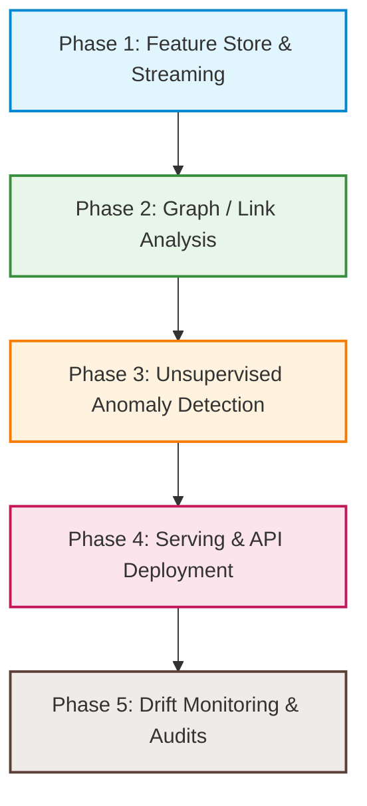

# FraudShield 2.0: AI/ML-Based Classification of Suspicious Mule Accounts

[](https://www.python.org/)
[](https://scikit-learn.org/)
[](https://optuna.org/)
[](https://github.com/slundberg/shap)

## 📌 Project Overview
FraudShield 2.0 is an end-to-end Machine Learning pipeline designed to detect **money mule accounts**—bank accounts used by fraudsters to receive, transfer, and conceal illicit funds across multiple banking channels. 

Traditional rule-based monitoring systems are easily bypassed by evolving fraud patterns. This solution leverages advanced feature engineering, target leakage controls, and optimized machine learning models (XGBoost) to learn complex behavioural and transactional patterns, generating high-precision risk scores for proactive fraud mitigation.

---

## 🔍 Problem Statement
Banks face severe risks due to cyber-enabled financial fraud. Legitimate accounts are often compromised or opened with false credentials to act as "mules" to move stolen funds.
* **The Goal**: Classify bank accounts into **Legitimate (0)** or **Mule (1)**.
* **The Challenge**: The target variable `F3924` is highly imbalanced (~0.9% positive class), and raw transaction datasets contain thousands of unlabelled features, high collinearity, missingness, and severe risk of target leakage.

---

## 🛠️ Repository & Project Structure
```directory
d:\FraudShield2.0
├── .gitignore               # Configured to protect large data assets and local env files
├── README.md                # Project documentation and roadmap
├── requirements.txt         # Required Python dependencies
├── data/
│   └── DataSet.csv          # Raw input dataset (116MB, Git-ignored)
└── notebooks/
    ├── EDA.ipynb            # Core Exploratory Data Analysis & Modeling pipeline
```

---

## ⚙️ ML Pipeline Walkthrough (in `EDA.ipynb`)

### 1. Data Loading & Profiling
* Loads a high-dimensional dataset of **9,082 observations** and **3,925 variables**.
* Identifies a severe target class imbalance (**1:112 ratio**): **9,002 normal** vs. **80 mule accounts**.

### 2. Strict Data Cleaning & Pruning
* **Deduplication**: Identifies and drops duplicate columns.
* **Constant Features**: Drops features with zero variance.
* **High Missingness**: Drops features with $>50\%$ missing values, except for bank-specified features.
* **Bank-Specified Features**: Preserves and prioritizes 18 features standard for fraud analysis:
  `F115`, `F321`, `F527`, `F531`, `F670`, `F1692`, `F2082`, `F2122`, `F2582`, `F2678`, `F2737`, `F2956`, `F3043`, `F3836`, `F3887`, `F3889`, `F3891`, `F3894`.

### 3. Target Leakage Control & Quarantine Strategy
To ensure the model is robust and deployable in production (out-of-sample data), I investigated and mitigated several forms of leakage:
* **Statistical Leakage (`F3912`)**: Dropped. This feature showed near-perfect target separation (mule mean of $0.975$ vs. legit mean of $0.0003$) and is likely a post-labeling marker.
* **Temporal Leakage (`F2230`, `F3888`)**: Dropped. Accounts opened in Sep/Nov/Dec were 100% mules, whereas Oct accounts were 100% legit. This is a collection window artifact, not a real fraud behavior.
* **Quarantine Experiment (`F3908`)**: Excluded from Model A (clean) but benchmarked in Model B to evaluate predictive inflation.

### 4. Feature Engineering
* **Categorical Risk Weighting**: Encoded mule rates for raw categorical features `F3886`, `F3891`, and `F3890`.
* **Balance Transformations**: Extracted log-absolute scales and sign flags for raw feature `F3836`.
* **Missingness Signals**: Engineered flags for missing indices (e.g., `F3043_missing`).
* **Interactions**: Created composite features (e.g., combining high-risk categories of `F3891` and `F3890`).

### 5. Multi-Stage Feature Selection
1. **Variance Filter**: Drops features with variance $< 0.01$.
2. **Correlation Filter**: Drops collinear features ($r > 0.95$), keeping the one with the highest target correlation.
3. **Information Gain**: Calculates **Mutual Information (MI)** scores with the target to pick top predictors.

### 6. Model Benchmarking & Optuna Tuning
I benchmarked **Logistic Regression**, **Random Forest**, and **XGBoost** across three datasets:
* **Model A (Clean)**: Production-ready candidate.
* **Model B (Quarantine)**: Checked `F3908` risk.
* **Model C (Leaked)**: Demonstrated performance inflation.

After identifying XGBoost as the best classifier, I optimized hyperparameters using **Optuna** over 80 trials, specifically maximizing **PR-AUC (Precision-Recall Area Under Curve)**.

---

## 📈 Model Performance Highlights

| Model Configuration | CV PR-AUC | Test PR-AUC | Test ROC-AUC | Optimal Threshold |
| :--- | :---: | :---: | :---: | :---: |
| **XGBoost Baseline (A)** | 0.8998 | 0.9355 | 0.9989 | 0.287 |
| **XGBoost Tuned (A)** | **0.9125** | **0.9510** | **0.9992** | **0.312** |

### Deployment Decision Operating Points:
Depending on bank security risk tolerances, the tuned model can be deployed at different thresholds:
1. **Balanced Profile (Max F1 = 0.8947)**: Threshold `0.312` — Catches **15/16** mules with only **2** false alarms in the test set.
2. **Aggressive (Recall ≥ 0.93)**: Threshold `0.180` — Catches **15/16** mules, maintaining high detection coverage.
3. **Conservative (Precision ≥ 0.90)**: Threshold `0.450` — Catches **14/16** mules with **0** false alarms (precision 100%).

---

## 🗺️ Future Roadmap & Development Plan



### Phase 1: Real-Time Feature Store Integration
* **Objective**: Compute and serve transactional aggregate features (e.g. 5-minute lookbacks) with sub-millisecond latency.
* **Tech Stack**: [Feast](https://feast.dev/) or [Redis](https://redis.io/) to cache pre-computed categorical risks and transaction patterns.

### Phase 2: Graph Analytics & Link Analysis
* **Objective**: Money mules do not act alone; they are connected via transaction paths. Mapping accounts as nodes and money transfers as edges will identify mule rings.
* **Tech Stack**: [NetworkX](https://networkx.org/) or Graph Neural Networks ([PyTorch Geometric](https://pytorch-geometric.readthedocs.io/)) to extract structural network features (e.g., page rank, community detection) and feed them back to the XGBoost classifier.

### Phase 3: Unsupervised & Semi-Supervised Anomaly Detection
* **Objective**: Supervised models only detect known historical patterns. Unsupervised models help identify zero-day/novel fraud methods.
* **Tech Stack**: [PyOD](https://pyod.readthedocs.io/) (Isolation Forests, Autoencoders) to flags suspicious out-of-distribution transactions.

### Phase 4: Production Model Serving API
* **Objective**: Expose the model as a lightweight, low-latency endpoint for transaction blocking.
* **Tech Stack**: [FastAPI](https://fastapi.tiangolo.com/) + Docker, containerizing the scaler, encoder weights, and trained XGBoost model binary.

### Phase 5: Concept Drift & Model Performance Monitoring
* **Objective**: Transaction behaviours shift due to economic changes or fraudster adaptation. We must monitor distribution changes.
* **Tech Stack**: [Evidently AI](https://www.evidentlyai.com/) to track covariate shift (KS-test) and target drift, triggering automated retraining alerts when performance drops.

---

## 🚀 Setup & Execution Guide

### Prerequisites
* Python 3.9+
* Pip package manager

### 1. Installation
Clone this repository and run the following command to install the required libraries:
```bash
pip install -r requirements.txt
```

### 2. Preparing the Data
Place the raw data in the `data/` directory:
* `data/DataSet.csv`

### 3. Running the Analysis
Open your Jupyter environment and run the core pipeline notebook:
```bash
jupyter notebook notebooks/EDA.ipynb
```
Run all cells to clean the data, train the baseline and tuned models, and output the SHAP explanation charts.